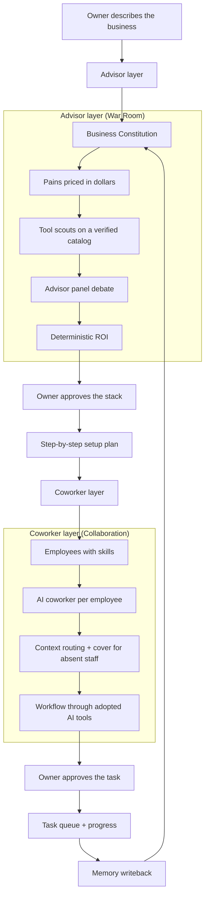
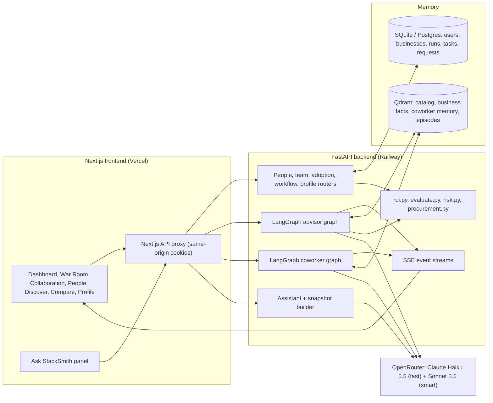
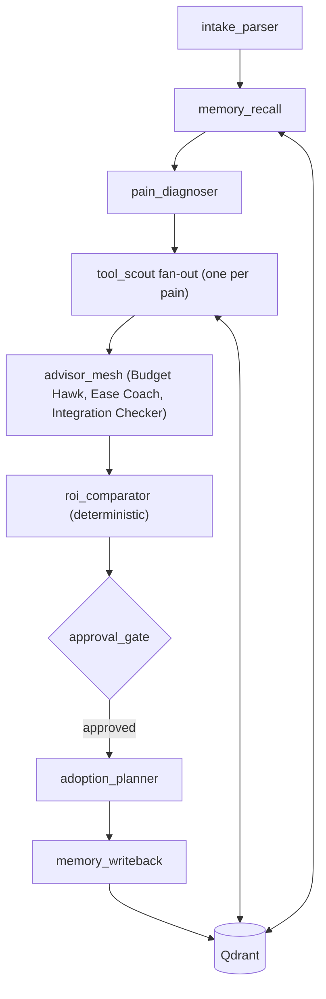
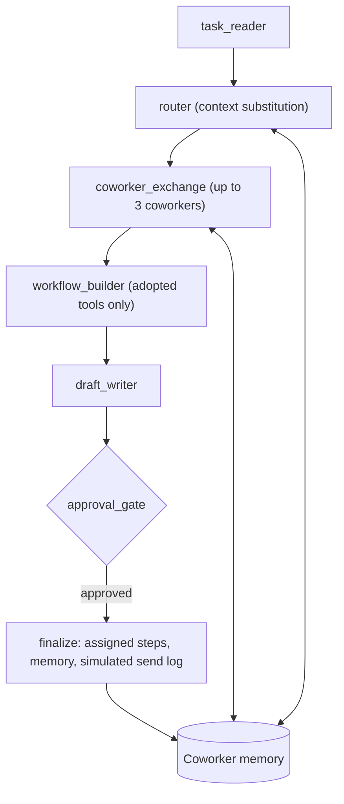
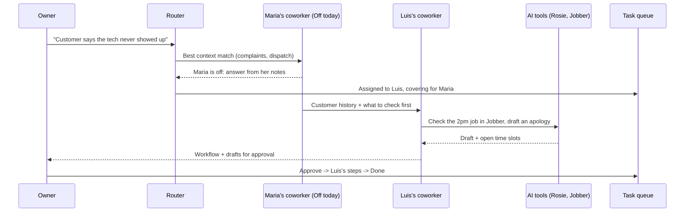

<div align="center">


### StackSmith - AI Advisors and Coworkers for Small Business

**A platform that helps small businesses discover, compare and adopt the right AI tools: advisor agents diagnose the business in dollars, AI coworkers that know each employee route real tasks through the tools, and the owner approves every step.**


AI for Small Business (AISB) Hack-a-thon, Fall 2026 - University of Maryland

**Live demo:** [stacksmith-tan.vercel.app](https://stacksmith-tan.vercel.app) - log in as a sample business owner or employee, no password needed.

</div>

---

## Technical Thesis

Small businesses are not short of AI tools. They are short of **fit**.

A coffee shop, an HVAC company and a landscaper face thousands of AI products, but the real questions are local: which problem costs us the most, which tool fixes it within our budget, does it work with what we already use, who on the team will run it, and will it actually pay for itself. Directories answer none of that. StackSmith turns it into a system layer.



**StackSmith is the missing layer between a small business and the AI market.** It makes adoption grounded in the business's own numbers, explainable, and owned by the team that will use it.

---

## Why StackSmith Exists

Owners of mom-and-pop restaurants, coffee shops, A/C repair shops and landscaping companies know AI could help. What they cannot easily answer is:

- which of our problems is worth solving first,
- which tool fixes it, and what it really costs per month and over a year,
- whether it connects to the tools we already pay for,
- who on the team will use it, and what happens when that person is out,
- how to set it up this week without a consultant.

That knowledge normally lives in the owner's head, in vendor marketing pages, and in trial and error.

StackSmith makes it explicit. Every business gets a persistent **Business Constitution**, a vector memory of its profile, budget, tools and pains. Every employee gets an **AI coworker** that knows their skills, responsibilities and the tools they use. Advisors recommend; coworkers execute; the owner approves.

The result is a platform that can explain:

```text
what each problem costs per month, with the math shown
why each tool was recommended, and what the advisors pushed back on
what the stack costs and when it pays for itself
which employee should handle a task, and who covers when they are off
which steps an AI tool now does instead of a person
what was learned for next time
```

---

## What StackSmith Does

StackSmith covers the full adoption lifecycle: **find, compare, trust, decide, roll out, and run day to day with the team.**


| Step | What happens |
|---|---|
| **Intake** | The owner describes the business in plain words, or picks a general example (Food & drink, Home services, Beauty & wellness...). |
| **Diagnosis** | The Pain Diagnostician turns "we miss calls" into "about $4,500/month in lost jobs" and shows the arithmetic. |
| **Scouting** | Tool scouts fan out per pain and search a verified catalog of 39 real tools. Any tool not in the catalog is blocked. |
| **Advisor panel** | A Budget Hawk, an Ease-of-Use Coach and an Integration Checker challenge every pick. |
| **ROI** | A plain Python calculator (not the AI) computes value, cost, net and payback, then picks a lean stack within budget. |
| **Approval** | The graph pauses until the owner approves the stack. |
| **Setup plan** | A specific, numbered checklist per tool ("In your phone carrier settings, set call forwarding to Rosie after 3 rings"). |
| **Collaboration** | The owner writes a task; it is assigned to the best-fit employee immediately, coworkers exchange context, and the workflow runs through the adopted tools. |
| **Task queue** | Planning, Needs your OK, In progress, Done, with each person ticking off their own steps. |
| **Learning loop** | Approved stacks and finished tasks are written back to business and coworker memory. |

In short: **StackSmith is not a tool directory. It is an advisor team plus a coworker mesh that turns AI tools into a working, owned workflow.**

### The core loop

| Phase | StackSmith's job | Why it matters |
|---|---|---|
| **Understand** | Build a Business Constitution and price each pain in dollars. | Owners decide on money and time, not features. |
| **Find** | Semantic search and scouts on a verified catalog. | No invented tools, no affiliate noise. |
| **Debate** | Advisors critique cost, ease and integration. | Surfaces the catch before the owner pays. |
| **Decide** | Deterministic ROI and a human approval gate. | Every number is auditable; the owner stays in control. |
| **Adopt** | Step-by-step setup plan and an Adopt button anywhere in the app. | Recommendations turn into action this week. |
| **Collaborate** | Route real tasks to the right person's AI coworker, through the adopted tools. | Shows the tools working inside the team, not in isolation. |
| **Learn** | Write outcomes back to memory. | The next recommendation and the next task get smarter. |

---

## What Judges Should Notice

| Signal | Why it is impressive |
|---|---|
| **Dollar-first diagnosis** | Every pain has a monthly cost and visible math; every tool has value, net and payback computed in code, not by the model. |
| **No hallucinated tools** | Agents can only recommend catalog IDs. Unknown suggestions are dropped and the War Room says so. |
| **Live advisor debate** | The War Room streams intake, diagnosis, scouts and three advisors pushing back before the owner sees a stack. |
| **AI coworkers per employee** | Each person has a coworker with their skills, tools and memory, like AUBI's Context Constitutions applied to a small business. |
| **Context substitution** | Tasks route to the person whose context fits; if they are off today, their coworker answers from their notes and the best available colleague does the hands-on step. |
| **Tools replace manual steps** | The workflow map shows "~~Dana typed each message by hand~~ -> Jobber does it". |
| **Owner and employee views** | Owners approve, see spending and run analyses; employees see their own tasks and request tools. Permissions are enforced on the server. |
| **Honest trust data** | 36 security and privacy facts across 13 tools are sourced from vendors' own pages with a link, date and quote. Everything else says "unknown". |
| **Ask StackSmith** | A page-aware assistant that sees the whole business (spending, people, tasks, plan) and answers with real numbers. |
| **Demo-ready at $0** | Sample businesses replay recorded runs; templates for new accounts are pre-cached. A full live analysis costs about $0.03. |

---

## Demo Script

1. Open the landing page, then **Try a sample business** and choose **Log in as owner (Maria Okafor)** for CoolAir HVAC.
2. **Dashboard**: the stack (Rosie + Jobber), money saved per month, this week's setup steps, and "How your team works with AI".
3. **War Room**: press **Watch the advisors work**. See pains priced in dollars, scouts, the advisor debate, the ROI table, then **Approve**.
4. **Discover**: search "answer my phone when I'm busy", open a tool's details, then **Compare** three tools (weighted scores, 12-month cost, works-with-your-tools).
5. **Collaboration -> Task queue**: write "Customer says the tech never showed up for her 2pm appointment". It is assigned to **Luis Ortega, covering for Maria** (Maria is off today). Open the task to watch the coworker mesh, workflow and drafts, then **Approve**.
6. Log in as the employee (**Luis Ortega**). See the task under **Mine**, open it, and tick off the steps. Log back in as the owner and see it **Done**.
7. **People**: click a person to see the AI tools they use. **Collaboration -> Spending**: approve a staff tool request against the monthly limit.
8. Open **Ask StackSmith** on any page: "What's our spending limit and can we afford the pending requests?"

The strongest moment is the chain:

```text
owner's words -> pains in $ -> advisor debate -> approved stack -> setup plan -> team task -> best-fit coworker (covering for absent staff) -> AI tools do the steps -> employee ticks off -> Done -> memory
```

---

## Product Surface

| Page | Purpose |
|---|---|
| **Dashboard** | Owner: stack, savings, this week's steps, team workflow card. Employee: my tasks, my AI tools, my requests, my workflow. |
| **War Room** | Owner-only. Live advisor run: intake, memory, diagnosis, scouts, advisor panel, ROI table, approval, setup plan. Includes a replay of how the advisors worked. |
| **Collaboration** | Task queue (auto-assigned tasks with stages and progress), Workflow graph (people, AI tools, customers, real hand-offs), Spending (requests, limit, seats, unapproved tools). |
| **Task page** | One task: assignee, cover note, animated coworker mesh with replay, workflow map, copy-ready drafts, step checklist, approval, simulated send log. |
| **People** | Everyone on the team once: skills, status (Available / Busy / Off today), AI coworker memory, the AI tools each person uses, invite links. |
| **Discover** | Semantic search over the verified catalog, general business categories, tool-type icons, details drawer with vendor link, Adopt (owner) or Request (employee). |
| **Compare** | Side-by-side scorecard with adjustable weights, 12/36-month total cost, integration checks, trust summary. |
| **Profile** | "You" card (name, Owner or Employee, job role, status) and the editable business profile. |
| **Ask StackSmith** | Floating assistant on every app page with a whole-business snapshot and a site map. |

---

## Architecture



---

## Advisor Graph (War Room)



| Node | What it does |
|---|---|
| `intake_parser` | Turns the owner's words into a structured profile, raw pains and Constitution facts. Structured answers from onboarding override the model. |
| `memory_recall` | Pulls the business's earlier facts and adoptions, plus what similar businesses chose. |
| `pain_diagnoser` | Picks the top 3 pains and prices each in dollars per month, with the arithmetic shown. |
| `tool_scout` | One scout per pain searches the catalog semantically; it can only pick catalog IDs. Security must-haves are enforced in code. |
| `advisor_mesh` | Three advisor personas critique the shortlist in parallel. |
| `roi_comparator` | Python computes value, net, payback and fit, then picks a lean stack within budget (one tool per job, no overlap). |
| `approval_gate` | LangGraph interrupt; resumes only when the owner approves. |
| `adoption_planner` | Writes a specific numbered setup checklist per approved tool. |
| `memory_writeback` | Saves facts and adoption episodes to the Business Constitution. |

---

## Coworker Graph (Collaboration)



| Node | What it does |
|---|---|
| `task_reader` | Reads the owner's task: intent, urgency, skills and capabilities needed. |
| `router` | Scores every employee on skills, responsibilities and memory. The best match owns the context; if they are **Off**, their coworker still answers from their notes and the best **Available** colleague takes the hands-on step. The assignee is set immediately. |
| `coworker_exchange` | The owning coworker and up to two neighbours share what they know ("this customer had a no-show last month"). |
| `workflow_builder` | Builds ordered steps through the adopted tools, marking which manual step each tool replaces. Steps no tool covers become gaps with catalog recommendations. |
| `draft_writer` | Writes copy-ready customer replies, staff messages and review responses. |
| `approval_gate` | Waits for the owner. |
| `finalize` | Creates the assignee's dashboard steps, writes coworker memory, and shows a send log labeled "Simulated - nothing was sent". |

Task stages: `planning -> needs_ok -> in_progress -> done` (or `rejected`). Progress is the assigned steps ticked off.

---

## Context Substitution

StackSmith borrows AUBI's coworker idea and applies it to a small team. "Context substitution" covers three things:

| Kind | Example |
|---|---|
| **Route to the right context** | A billing question goes to Dana's coworker because Dana handles invoices. |
| **Cover for absent staff** | Maria is off today, so her coworker answers from her notes and Luis takes the call. |
| **Tools replace manual steps** | "~~Maria types the quote by hand~~ -> Jobber drafts it, Maria approves." |



---

## Memory

| Store | What it holds |
|---|---|
| **Business Constitution** (Qdrant `business_facts`) | Profile, budget, current tools, goals, pains, adoptions. Shown on Profile. |
| **Coworker memory** (Qdrant, employee scope) | Each employee's skills, responsibilities, tools and past task roles. Shown in the People drawer. |
| **Episodes** (Qdrant `episodes`) | Approved stacks and finished tasks, used for "similar businesses chose..." and future routing. |
| **Tool catalog** (Qdrant `tool_catalog`) | 39 hand-checked tools with taxonomy, pricing model, integrations and trust facts. Embedded with fastembed `all-MiniLM-L6-v2` (384-d). |

A fact looks like:

```json
{
  "subject": "business",
  "predicate": "uses",
  "object": "QuickBooks",
  "category": "current_tools",
  "confidence": 0.9
}
```

---

## Trust, Honesty and Cost Controls

| Rule | How it is enforced |
|---|---|
| **No invented tools** | Agents may only output catalog IDs; anything else is dropped and logged as a guard event. |
| **No invented trust data** | Each trust field is `verified`, `vendor_claimed` (with source URL, date and quote) or `unknown`. 36 facts are sourced; the rest are honestly unknown (`backend/data/trust_sources.md`). |
| **Math in code, not the model** | ROI, total cost of ownership, weighted scores, spend limits and risk levels are pure Python with unit tests. |
| **Owner stays in control** | Stacks and tasks wait for approval; employees request, owners approve. Server-side permission checks. |
| **Nothing is sent** | Customer messages are drafts; the send log is labeled simulated. |
| **Budget guard** | Every LLM call goes through one client with a spend cap, response cache and per-user rate limits. Sample businesses replay recorded runs at $0. |
| **Secrets guard** | The assistant never forwards anything that looks like a password, API key or card number to the model. |

---

## Tech Stack

| Layer | Technology |
|---|---|
| Frontend | Next.js 15, React 19, TypeScript, Tailwind CSS, Framer Motion, lucide-react |
| Backend | FastAPI, Python 3.12, LangGraph (MemorySaver + interrupts), httpx |
| Memory | Qdrant (Cloud or embedded on-disk) with fastembed `all-MiniLM-L6-v2` |
| Database | SQLite on a Railway volume, or Postgres via `DATABASE_URL` |
| LLM | OpenRouter: Claude Haiku 5.5 (fast tier), Claude Sonnet 5.5 (smart tier) |
| Streaming | Server-Sent Events through a same-origin Next.js proxy |
| Auth | Email + password (bcrypt), JWT in an httpOnly cookie; owner / employee roles with invite links |
| Deployment | Railway backend (Docker, one worker), Vercel frontend |

---

## Repository Map

```text
backend/
  main.py                       FastAPI app: auth, businesses, runs, catalog, evaluate, dashboard
  llm.py                        The only OpenRouter client: JSON validation, cache, spend cap
  roi.py / evaluate.py          Deterministic ROI, scorecard, TCO, integration checks
  risk.py / procurement.py      Risk matrix from catalog facts; spend-limit math
  coworkers.py                  Employees, coworker tasks, stages and progress
  workflow_map.py               Real-data workflow graph (people, tools, hand-offs)
  adoptions.py / people.py      Adopted stack + scenario refresh; person view and AI tools per person
  graphs/
    advisor_graph.py            War Room LangGraph
    coworker_graph.py           Collaboration LangGraph (routing, substitution, workflow, drafts)
    prompts.py / state.py       All prompts and Pydantic schemas
    events.py                   SSE run channels
  routers/                      assistant, adoption, coworkers, people, profile, team, workflow
  memory/store.py               Qdrant catalog, business facts, coworker memory, episodes
  data/                         catalog.json, personas, recorded demo runs, trust sources
  scripts/                      precompute demos, enrich catalog, extend trust schema, parse policy
  tests/                        106 tests (ROI, evaluate, risk, catalog, coworkers, people, permissions, assistant...)

frontend/src/
  app/                          dashboard, war-room, team (Collaboration), team/tasks/[id], people,
                                tools, tools/[id], compare, profile, onboard, login, join/[code]
  components/                   agent-graph, workflow-graph, war-room, coworkers/*, team/*,
                                assistant, tool-quickview, adopt-button, hero-slideshow, ui
  hooks/                        useRunStream, useCoworkerTask, useAdoptions
```

---

## API Surface

| Endpoint | Purpose |
|---|---|
| `POST /auth/register` | Sign up as `owner` or `employee` (employees join with an invite code). |
| `POST /auth/demo/{persona}` | One-click sample login; `?as=employee` logs in as that business's employee. |
| `GET /me` | User, business, `account_role`, `person_id`. |
| `POST /runs`, `GET /runs/{id}/stream`, `POST /runs/{id}/approve` | Start, stream and approve a War Room analysis (owner only). |
| `GET /catalog`, `GET /catalog/search?q=` | Verified catalog and semantic search. |
| `GET /tools/{id}` | Tool details, reviews, trust facts and risk matrix. |
| `POST /evaluate` | Weighted scores, 12/36-month TCO and integration checks. |
| `GET/POST/DELETE /adoptions` | Adopted stack (owner); employees use tool requests instead. |
| `GET/POST/PATCH/DELETE /people` | People with skills, status, AI coworker memory and AI tools; invite links. |
| `POST /coworker-tasks`, `GET /coworker-tasks?scope=mine|all` | Create a task (auto-assigned) and read the queue. |
| `GET /coworker-tasks/{id}/stream`, `POST /coworker-tasks/{id}/approve` | Stream and approve a coworker task. |
| `GET /workflow-map` | People, tools and real hand-offs for the workflow graph. |
| `GET /team`, `POST /team/requests`, `POST /team/requests/{id}/decide` | Spending, tool requests and approvals. |
| `POST /plan-tasks`, `PATCH /plan-tasks/{id}` | Publish a task (with tool suggestions) and tick steps. |
| `POST /assistant/chat` | Ask StackSmith, with page context and a whole-business snapshot. |
| `GET /ready` | Health, catalog size, AI spend vs cap. |

---

## Local Setup

### 1. Backend

```bash
cd backend
python -m venv .venv
.venv/Scripts/activate          # macOS/Linux: source .venv/bin/activate
pip install -r requirements.txt
cp .env.example .env
```

Fill in:

```bash
OPENROUTER_API_KEY=sk-or-...
MODEL_FAST=anthropic/claude-haiku-5.5
MODEL_SMART=anthropic/claude-sonnet-5.5
SPEND_CAP_USD=18
JWT_SECRET=change-me
ADMIN_TOKEN=change-me
# optional: QDRANT_URL / QDRANT_API_KEY (else embedded Qdrant), DATABASE_URL (else SQLite)
```

Run:

```bash
uvicorn main:app --port 8000 --workers 1
pytest -q
```

### 2. Frontend

```bash
cd frontend
npm install
BACKEND_URL=http://localhost:8000 npm run dev
```

Open `http://localhost:3000` and pick a sample business.

### 3. Demo data

```bash
cd backend
python -m scripts.precompute_demos            # record the War Room runs for sample businesses
python -m scripts.precompute_coworker_demos   # record the coworker tasks
```

`POST /admin/reset-demos` (with `x-admin-token`) restores the sample businesses at any time.

---

## Deployment

### Railway Backend

`backend/railway.toml` builds `backend/Dockerfile` (the embedding model is baked into the image). A volume mounted at `/data` holds SQLite and embedded Qdrant:

```bash
DATABASE_URL=sqlite:////data/stacksmith.db
QDRANT_PATH=/data/qdrant
COOKIE_SECURE=true
```

Run one worker so paused approvals in the in-memory LangGraph checkpointer survive between requests.

### Vercel Frontend

Deploy `frontend/` with:

```bash
BACKEND_URL=https://your-railway-backend
```

The browser only talks to the Next.js proxy, so cookies stay first-party and no secrets reach the client.

---

## Why This Is Different From an AI Tool Directory

| AI tool directory | StackSmith |
|---|---|
| Lists thousands of tools by category. | Diagnoses the business and prices each problem in dollars first. |
| Ratings and affiliate links. | Advisor debate, deterministic ROI and sourced trust facts. |
| Ends at "visit site". | Continues through approval, a step-by-step setup plan and adoption. |
| Treats the business as one buyer. | Models the team: owner and employees, each with an AI coworker. |
| Tools stay separate. | Shows tasks flowing through the adopted tools, with hand-offs between people and tools. |
| Forgets after the visit. | Writes outcomes back to the Business Constitution and coworker memory. |

---

## Hackathon Scope

Implemented:

- War Room advisor graph with live streaming, approval gate and step-by-step setup plans.
- Verified 39-tool catalog with semantic search, taxonomy, pricing models and sourced trust facts.
- Discover, tool pages and Compare (weighted scorecard, TCO, integration checks, risk matrix).
- Adopt (owner) and Request (employee) flows with a monthly spending limit.
- Owner and employee accounts, invite links, and server-enforced permissions.
- People with AI coworkers, statuses and per-person AI tools.
- Coworker graph with context substitution, workflow through adopted tools, drafts and approval.
- Task queue with auto-assignment, stages and progress; per-task pages with replayable animation.
- Real-data workflow graphs for owners and employees.
- Ask StackSmith: page-aware assistant with a whole-business snapshot.
- Sample businesses (CoolAir HVAC, Joe's Corner Coffee, GreenLeaf Landscaping) that replay at $0.
- Railway backend and Vercel frontend deployment.

Next:

- 30/60/90-day check-ins comparing predicted savings with actual results.
- Sourcing trust facts for the remaining catalog tools.
- Email invites and notifications instead of copy-paste links.
- Persistent LangGraph checkpointing for multi-worker deployments.
- Real integrations (calendar, POS, accounting) so diagnoses use live data instead of self-report.

---

<div align="center">

**StackSmith is AI adoption that knows the business and the team, not just the tool list.**

</div>
